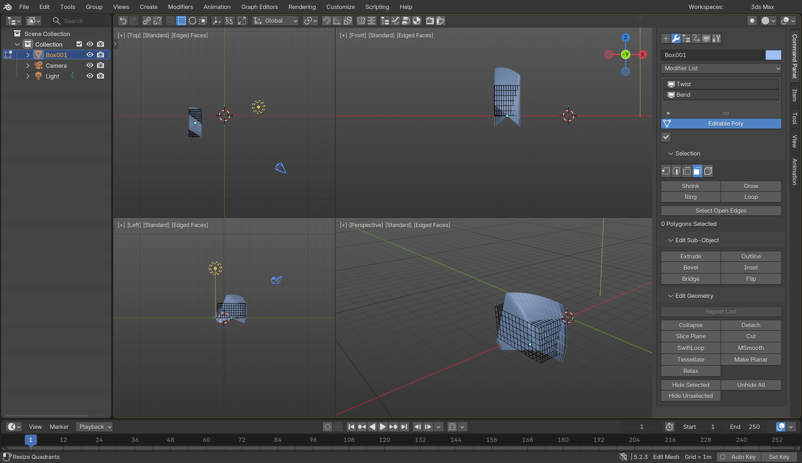
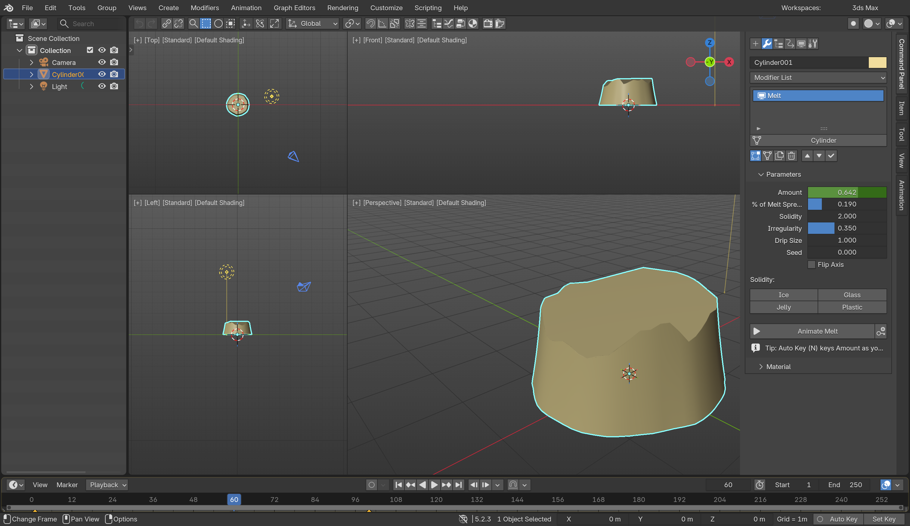

# NotuoDesk 3ds Maxxed

A Blender add-on (Blender 4.2+, tested on 5.2.3 LTS) that makes Blender look and work like Autodesk 3ds Max. It's aimed at people who know both apps.





## Install

1. In Blender, open **Edit › Preferences › Get Extensions**, click the **⌄** menu (top right), then **Install from Disk…**
2. Pick `notuodesk_3ds_maxxed-1.2.2.zip` (download it from this repo's **Releases** page).
3. On first enable, the add-on applies the 3ds Max theme and adds a **3ds Max** workspace, then switches you to it.

To go back to normal Blender, choose **Customize › Restore Blender Look**, or turn the add-on off. Turning it off removes every hotkey and menu change. The theme stays as it is until you restore it.

## What you get

| 3ds Max | In Blender |
|---|---|
| Menu bar: File, Edit, Tools, Group, Views, Create, Modifiers, Animation, Graph Editors, Rendering, Customize, Scripting, Help | Replaces Blender's top menus. Blender's own menus are still there as sub-menus |
| Workspaces dropdown | Top right, replaces the workspace tabs |
| Main Toolbar | Viewport header: undo/redo, link/unlink, select by name, region select, move/rotate/scale, reference coordinate system, pivot, snaps, mirror, align, editors, render |
| Scene Explorer | Outliner on the left |
| 4 viewports: Top, Front, Left, Perspective | Quad view with `[+] [Top] [Standard] [Edged Faces]` labels |
| Command Panel: Create, Modify, Hierarchy, Motion, Display, Utilities | Right sidebar with collapsible rollouts |
| Click-drag creation (base first, then height) | Box, Cone, Sphere, GeoSphere, Cylinder, Tube, Torus, Pyramid, Plane. Right-click stops creating |
| Parametric primitives | Length/Width/Height/Segs stay editable in **Parameters** until you convert to Editable Poly or enter sub-object mode |
| Modifier List and stack | About 60 modifiers under their Max names (see below). Newest is on top, with a visibility toggle per modifier |
| Editable Poly | Selection, Edit Vertices/Edges/Borders/Polygons/Elements and Edit Geometry rollouts |
| Quad menus | Right-click (display / tools / transform) and Ctrl+right-click (modeling) |
| Status bar | "1 Object Selected", X/Y/Z type-in, Grid, Auto Key, Set Key |
| Look | Max dark UI, cyan selection outline, red sub-object selection, blue vertices, random object colors, names like Box001 |

## Modifiers

**Built for this add-on** (Geometry Nodes, because Blender has no equivalent):
**Melt** (Amount, % of Melt Spread, Solidity with Ice/Glass/Jelly/Plastic presets, Irregularity, Drip Size, Seed, Flip Axis). Click **Animate Melt** to keyframe it from solid to puddle over a frame range, or key Amount yourself with Auto Key (N), the key button, or right-click › Insert Keyframe, **Skew**, **Squeeze**, **Slice**, **Noise**, **Push**, **Spherify**.

**FFD 2x2x2 / 3x3x3 / 4x4x4 / FFD Box** each create an orange lattice cage fitted to the object.

**Mapped to Blender's own modifiers:** Edit Poly, Symmetry, Mirror, Vertex Weld, ProOptimizer, Optimize, MultiRes, Turn to Mesh, Delete Mesh, Smooth, Edit Normals, Weighted Normals, Retopology, Quadify Mesh, TurboSmooth, MeshSmooth, OpenSubdiv, Tessellate, Subdivide, HSDS, Shell, Chamfer, Array, Boolean, ProBoolean, Lattice, Skin, Displace, Bend, Twist, Taper, Stretch, Relax, Smooth Deform, Wave, Ripple, Affect Region, Shrink Wrap, Conform, Path Deform, Skin Wrap, Skin Morph, Skin (bones), Linked XForm, UVW Map, Unwrap UVW, UVW XForm, Extrude, Lathe, Sweep, Cloth, Flex, Point Cache, Particle Flow, Hair and Fur, and Ocean.

## V-Ray

- **If Chaos V-Ray for Blender is installed** (there is a free Community Edition), it's detected automatically. **Rendering › V-Ray › Renderer: V-Ray** makes it the active renderer, and the same menu lists V-Ray's own tools.
- **Without V-Ray installed**, you still get the V-Ray workflow, rendered in Cycles:
  - **VRayMtl**: Default, Glossy Plastic, Brushed Metal, Chrome, Glass, Car Paint, VRayLightMtl. Edit it in Modify › Material using V-Ray parameter names (Diffuse, Reflect, Refl. Glossiness, Metalness, Fresnel IOR, Refract, Opacity, Coat, Self-Illumination).
  - **VRayLight**: Plane, Disc, Sphere, Dome (choose an HDRI), plus VRaySun with VRaySky, and VRayIES.
  - **VRayPhysicalCamera**: film gate, focal length, F-number, shutter speed and ISO drive scene exposure. f/8, 1/200 s and ISO 100 count as 0 EV.
  - **VRayPlane**: an effectively infinite ground plane.
  - **Quality presets** (Draft, Medium, High, Very High) use progressive sampling with a noise limit and the denoiser.
- These objects are standard Blender lights, cameras and Principled materials, so V-Ray for Blender's Cycles-to-V-Ray conversion can handle them. I couldn't test that conversion because V-Ray isn't installed on the test machine.

## Hotkeys

| Keys | Action |
|---|---|
| Q / W / E / R | Select / Move / Rotate / Scale |
| MMB / Alt+MMB / Ctrl+Alt+MMB, wheel | Pan / Orbit / Zoom |
| Z / Ctrl+Shift+Z | Zoom Extents Selected / All |
| Alt+W | Maximize viewport toggle |
| T F L B K P U C | Top, Front, Left, Bottom, Back, Perspective, Orthographic, Camera |
| 1 2 3 4 5 (6) | Vertex, Edge, Border, Polygon, Element (exit) |
| H | Select From Scene |
| Ctrl+A / Ctrl+D / Ctrl+I | Select all / none / invert |
| Ctrl+click / Alt+click | Add to / remove from selection |
| F3 / F4 | Wireframe / Edged Faces |
| Alt+X / Alt+Q | See-Through / Isolate Selection |
| G / X / 7 | Grid / Gizmo / Statistics |
| S / A | Snaps / Angle Snap |
| N / K | Auto Key / Set Key |
| Ctrl+V / Ctrl+C | Clone / Camera from view |
| M / 8 / F10 | Material Editor / Environment / Render Setup |
| Shift+Q / F9 | Render |
| F12 / Ctrl+X | Transform Type-In / Expert Mode |
| O | Adaptive Degradation (lighter viewport for heavy scenes) |
| Shift+E, Ctrl+Shift+E, Ctrl+Shift+C | Extrude, Connect, Chamfer |
| Alt+C / Alt+L / Alt+R | Cut / Loop / Ring |
| Backspace / Ctrl+Backspace | Remove / Remove with vertices |
| Ctrl+PgUp / Ctrl+PgDn | Grow / Shrink |
| PgUp / PgDn | Select parent / child |
| , . Home End / | Previous/next frame, first/last frame, play |

You can switch each feature on or off (hotkeys, menu bar, toolbar, status bar, labels, random colors) under **Preferences › Add-ons › NotuoDesk 3ds Maxxed**.

## Known differences from 3ds Max

- Blender keeps one shading mode per viewport *area*, so all four quads share the same shading (Max can set it per viewport).
- There's no Teapot, ViewCube or Ribbon. Blender's navigation gizmo stands in for the ViewCube.
- Shift-drag cloning isn't supported. Use Ctrl+V (Clone), or Blender's Shift+D.
- Entering a sub-object level on a primitive converts it straight to Editable Poly; in Max you would add an Edit Poly modifier instead.

## Building from source

```bash
blender --command extension build --source-dir notuodesk_3ds_maxxed --output-dir .
```

## License

GPL-3.0-or-later (required for Blender add-ons). See [LICENSE](LICENSE).
